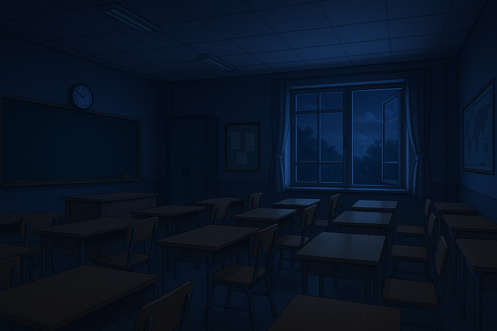

> [!IMPORTANT]
> 🇱🇻 **The game is entirely in Latvian.** All dialogues, messages, endings and the website interface are written in Latvian only.

## 🚀 Overview
**Unread Lines** is an interactive story game about a teenager's life at school. You play as a 15–16 year old who returns to Rēzekne after several years away and has to find his place in a new class. The whole game happens inside a custom-made messenger app: you receive messages, pictures and videos, talk to different characters and make decisions that affect your reputation and your relationships with other people.

The project was created as a 12th grade final work for the subject "Project Work". It combines programming and social sciences, with a focus on communication, thoughtful decision-making, responsibility, empathy and cooperation.

## 🔑 Key Features
- **Messenger-style gameplay:** The story is told through chats with different characters. Events that happen outside the app are described in a separate "Piezīmes" (Notes) conversation.

- **Choices with consequences:** Every answer you pick earns points and shapes your reputation. The ending shows the results of your decisions, just like in real life.

- **Five different endings:** Depending on your final score, you get one of five character profiles, from a quiet observer to the person who brought the whole class together.

- **Chapters and quotes:** The story is split into chapters (school events such as 1 September, the school picnic, the New Year show and graduation). Between chapters you see a dark transition screen with a quote.

- **Interactive city map:** A map of Rēzekne with places from the story (Ančupāni lookout tower, Olympic Centre, "GORS", School No. 2, Zeimuļs). Each place has a photo, a short story and links.

- **Personal touch:** The game asks for your name and uses it in the dialogues. Your progress is saved in the browser, so you can continue later or start a new game at any time.

- **Responsive design:** The website adapts to desktops and mobile devices.

## 🖼️ Screenshots


## 📖 Project history

- **2023 · First version**

  The first version was created in 2023 as a 12th grade final project. Because of limited time, not all of the original ideas were implemented. The main focus was the technical side, so the story stayed unfinished and not very well developed. It was built with **PHP**, **JavaScript** and a separate database, and the school's computer science teacher helped a lot with the server-side programming.

  👉 [Open the first version](https://skolenu-dzive.netlify.app/)

- **2025 · Rework**

  In 2025 Ņikita Andrejevs and Iļja Grabovskis decided to completely rework the game. This time the main focus was the story and the content: the plot was written from scratch, new events and game stages were added, and the overall structure of the game was changed. Special attention was paid to the ending, which now shows the consequences of the player's decisions more clearly, including their influence on reputation and relationships. PHP and the separate database were dropped in favor of plain **JavaScript** and **JSON** files that store dialogues, messages and other game data.

- **2026 · Open source**

  In 2026 the source code was published on GitHub so that anyone interested can explore how the project was made and, if they want, take part in its further development.

> [!NOTE]
> The authors do not plan to continue the development or update the game regularly, but would be happy if someone wanted to continue working on the project. The game has not been updated since 2025, so it may still contain bugs and imperfections. Both versions are no longer actively maintained.

## 🛠️ Technologies and development

- **Development:**

  The website was built using rather simple technologies such as **HTML**, **CSS** and **JavaScript**, with no frameworks. **JSON** is used to store all dialogues, messages, answers and quotes. The city map is built with **Leaflet** and **OpenStreetMap**.

      

## 📁 Project structure

```
unreadlines/
├── index.html        # Main page
├── game.html         # Messenger (the game itself)
├── map.html          # City map
├── about.html        # About the game
├── gameover.html     # Ending and results
├── data.json         # Dialogues, messages, answers and branches
├── phrases.json      # Quotes for transition screens
├── css/              # Styles (base, sidebar, game, index, about, ...)
├── js/               # Game logic, map, page scripts
├── images/           # Characters, places, chapter pictures
├── icons/            # Menu icons
└── video/            # Background video for the main page
```

## ▶️ Getting started

The project is a static website, so no build step is needed. Because the game loads its data from JSON files, it has to be opened through a local server (opening `game.html` directly from the file system will not work).

```bash
# clone the repository
git clone https://github.com/juicebct/unreadlines.git
cd unreadlines

# start any local server, for example:
python3 -m http.server 8000
```

Then open `http://localhost:8000` in your browser. You can also use the *Live Server* extension in VS Code.

## 👥 Authors

- **Iļja Grabovskis** ([@iljagrabovskis](https://github.com/iljagrabovskis)) – author of the original game idea. Responsible for the concept, the plot, the events and the organization of the project. Also took part in programming and technical development.

- **Nikita Andreev** ([@juicebct](https://github.com/juicebct)) – mainly responsible for technical development (website & design)

- **School computer science teacher** - gave significant help with the technical development of the first version, especially the backend. Did not take part in the 2025 rework.

## 🤝 Contributing

Contributions are welcome! If you would like to fix bugs, improve the code or continue the story, feel free to fork the repository and open a pull request.
